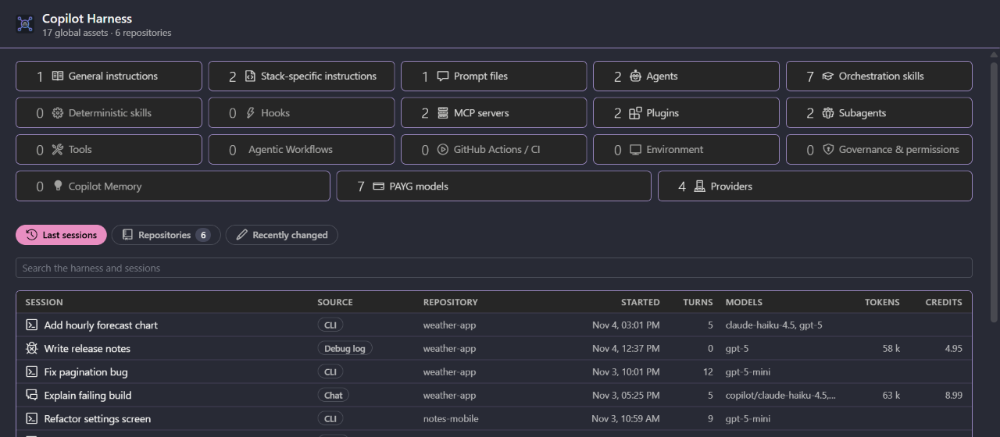
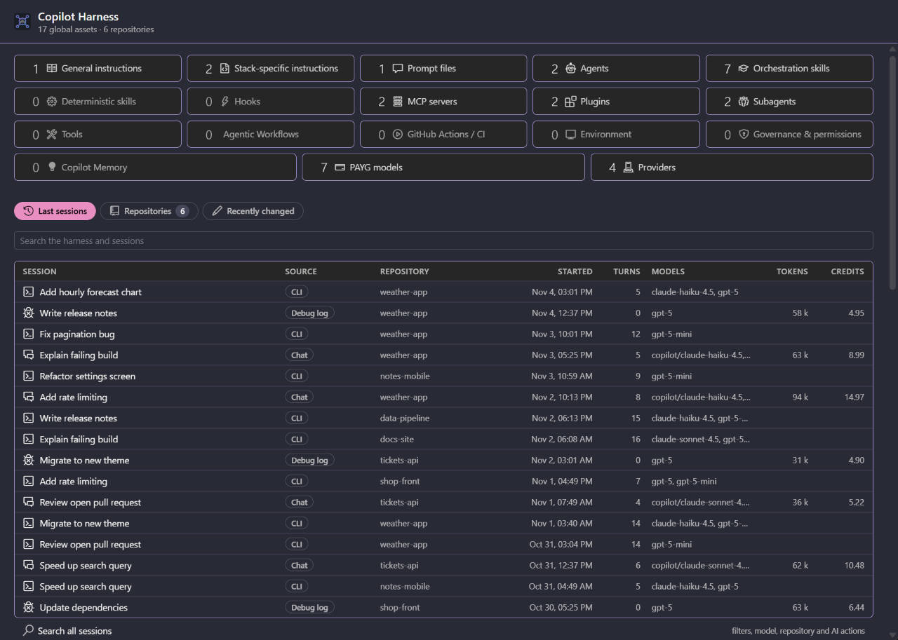
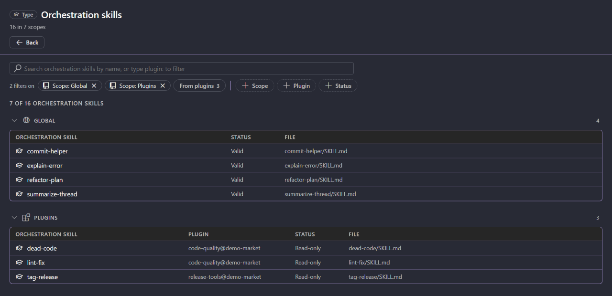
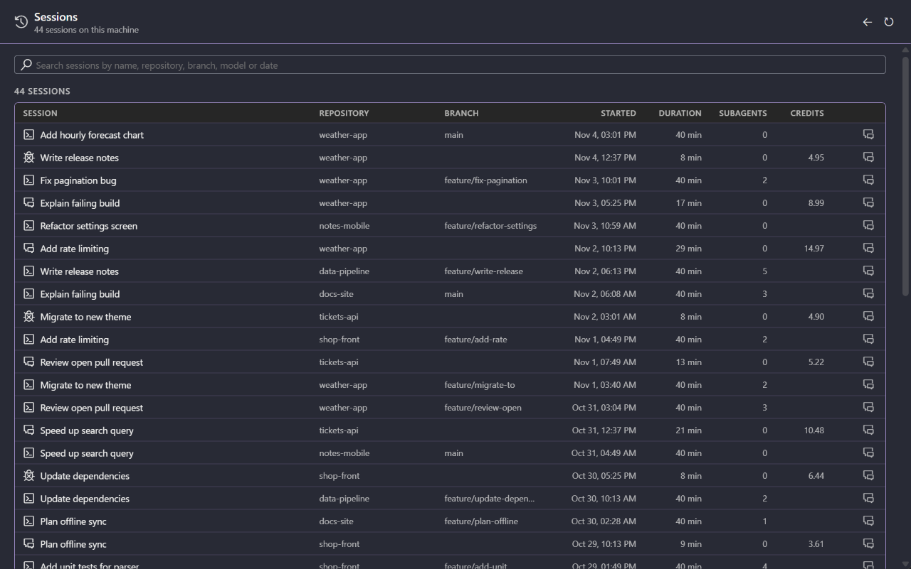
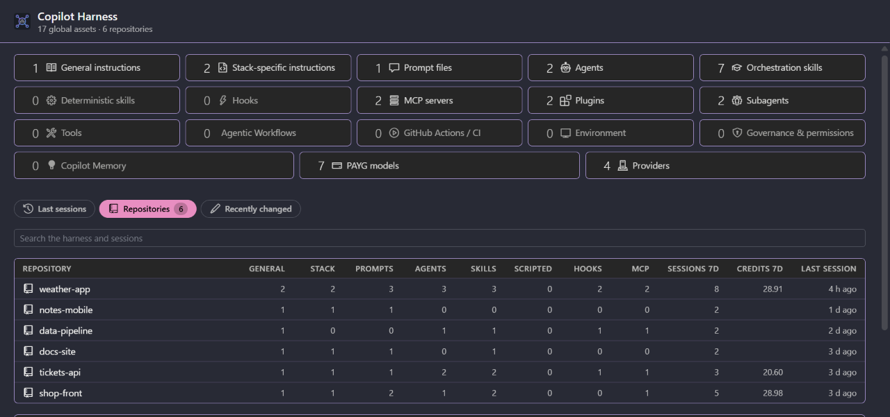
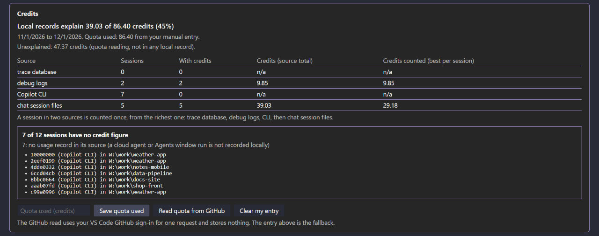
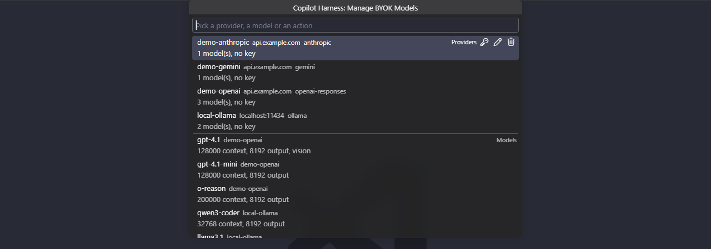
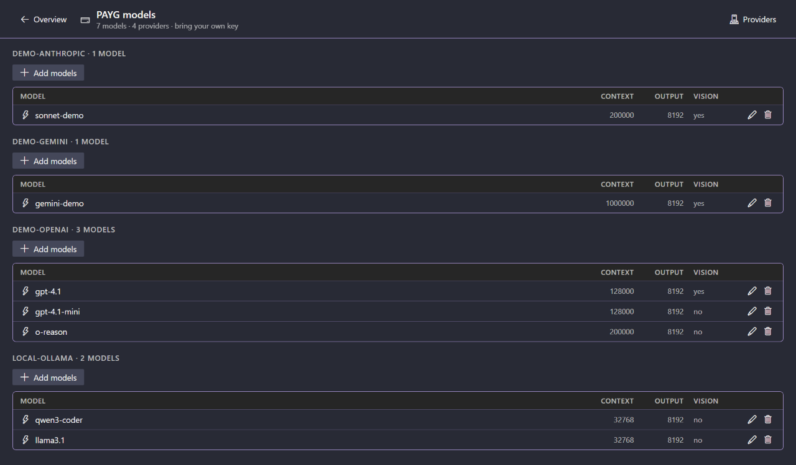
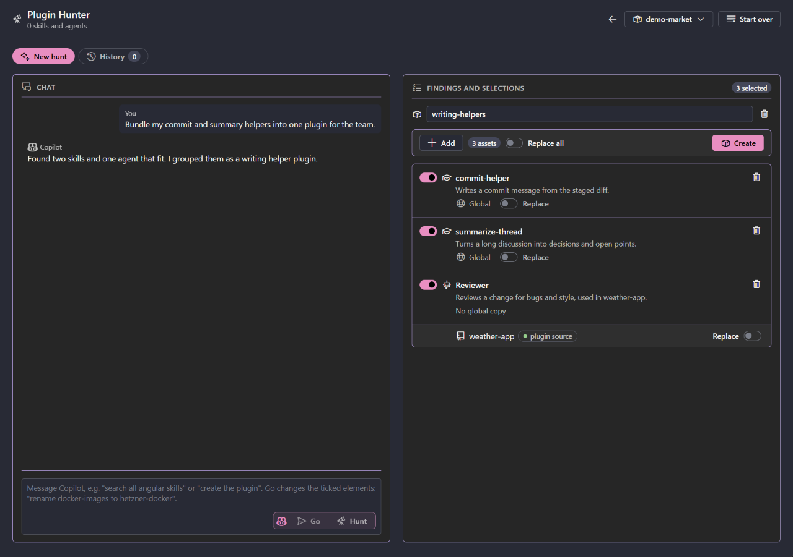
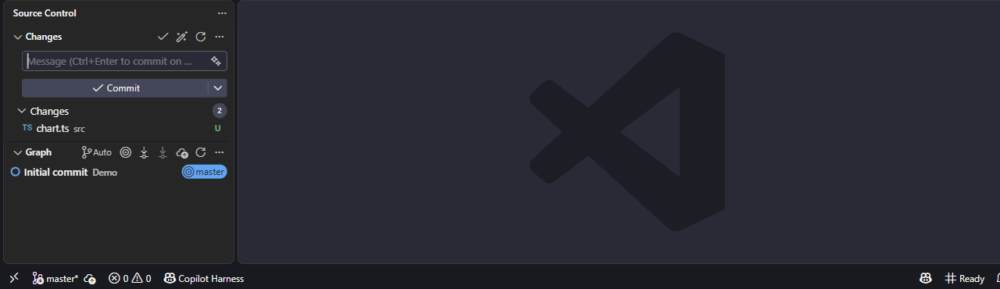

# Copilot Harness

**See what your Copilot harness holds, what your sessions cost, and bring your own models.**

Copilot Harness does for the GitHub Copilot harness what [Claude Harness](https://github.com/alexander-kastil/claude-harness) does for Claude Code. It lists every Copilot customization (instructions, prompt files, agents, skills, hooks, MCP servers, plugins), globally and per repository, and reads the session data Copilot already writes: which sessions ran, in which repository, with which models, and what they cost in tokens and credits.

It also adds your own models to Copilot Chat: any OpenAI-compatible, OpenAI Responses, Ollama, Anthropic or Gemini endpoint appears in the model picker, with your own key. BYOK models run on your own provider accounts and keys; Copilot Harness adds no charge.

## Quick start

Copilot Harness is not on the Marketplace yet. Install it from its VSIX.

1. In the Extensions view (Ctrl+Shift+X), open the **...** menu, pick **Install from VSIX...** and select `copilot-harness-<version>.vsix`, or run `code --install-extension copilot-harness-<version>.vsix`.
2. Click **Copilot Harness** in the status bar, or run **Copilot Harness: Open** from the Command Palette.
3. Pick an item in the left nav, or a session in **Last sessions**.
4. To add your own models, run **Manage BYOK Models**, or open the **PAYG models** tile.

Requires VS Code 1.119 or newer. The Copilot CLI is optional: its sessions are read from `~/.copilot` when that folder exists.

## What it reads

Customizations live in the workspace, each VS Code profile, `~/.copilot`, `~/.claude`, `~/.agents` and installed plugins. Session data sits in chat session files, debug logs, a trace database and the Copilot CLI's session state, and Copilot deletes some of it over time.

Copilot Harness reads all of it read-only. There is no proxy or server. Only numbers and names are kept: no prompt or response text, and of a customization file only its frontmatter keys.

## Features

| Feature | What it does |
| --- | --- |
| [Overview](#overview) | A tile per customization kind, your last sessions, repositories and recent changes |
| [Customizations](#customizations) | Every kind across the workspace, every VS Code profile, `~/.copilot`, `~/.claude`, `~/.agents` and plugins |
| [Sessions](#sessions) | Chat sessions, debug logs, the trace database and Copilot CLI sessions in one list, with turns, models, tokens and credits |
| [Repositories](#repositories) | Customizations by kind, sessions and credits of the last 7 days, last session |
| [Credits](#credits) | Local credit figures against the quota GitHub reports, and the unexplained remainder |
| [BYOK models](#byok-models-in-copilot-chat) | Your providers and models in the Copilot Chat model picker, five API modes, keys in VS Code's secret storage |
| [PAYG models page](#payg-models-page) | Everything Manage BYOK Models does, as a page |
| [Plugin Hunter](#plugin-hunter) | Copilot proposes a plugin from your skills and agents and creates it in a marketplace you own |
| [Commit messages and token meter](#commit-messages-and-token-meter) | Commit and pull request messages from a BYOK model, and context use in the status bar |

## Overview

The overview shows the asset and repository counts and a tile per customization kind with its global count, plus a **PAYG models** tile. Three tabs with a search box sit below:

- **Last sessions:** up to 300 sessions with source, repository, start, turns, models, tokens and credits. A Copilot CLI row shows the session's name, or its summary when it has none.
- **Repositories:** every repository with its counts per kind.
- **Recently changed:** the 100 customization files changed last.

The Setup, Credits and Snapshots cards follow.

## Customizations

The left nav has two regions. **Copilot** holds the global customizations. **Repositories** holds each repository, open folders first, with its kinds and **Sessions**.

| Kind | In a repository |
| --- | --- |
| Instructions | `.github/copilot-instructions.md`, `.github/instructions/*.instructions.md`, `AGENTS.md`, `CLAUDE.md` |
| Prompt files | `.github/prompts/*.prompt.md` |
| Agents | `.github/agents/*.agent.md`, `.claude/agents/*.md` |
| Skills | `SKILL.md` folders in `.github/skills`, `.claude/skills` and `.agents/skills` |
| Hooks | `.github/hooks/*.json`, `.github/hooks.json`, the hooks in `.claude/settings.json` |
| MCP servers | `.vscode/mcp.json`, `.mcp.json` |
| Plugins | `.github/plugins` and installed plugins (read-only) |

The profiles of Code, Code - Insiders, VSCodium and Cursor are all read. A row opens its file in the editor. **Add repo** and **Remove repo** change the list (remove only hides a repository). The nav has a filter, folds, sorting by recent or name, keyboard navigation, and collapses to a rail of icons with counts (Alt+Shift+B). Its state is kept between sessions.

## Sessions

| Source | What is read |
| --- | --- |
| Chat | VS Code chat session files of every installed VS Code variant: title, turns, models and times, rescanned incrementally |
| Debug log | Copilot Chat debug logs: tokens per call, tool counts and subagent runs |
| Trace DB | The OpenTelemetry trace database, opened read-only: token, cache and credit figures |
| CLI | Copilot CLI session state under `~/.copilot`: workspace, repository, branch, models, tool, subagent and skill counts, and every usage snapshot |

## Repositories

The **Repositories** tab and region list every repository with its customization counts per kind, its sessions and credits over the last 7 days, and its last session.

## Credits

The Credits card sets the credit figures from your local session data, per source, against the quota used. The quota is read from GitHub with your signed-in GitHub session when you press the button, and no token is stored. You can also type it in. Every figure names its source, and the remainder no local data explains is shown on its own.

## BYOK models in Copilot Chat

Copilot Harness registers as a language model provider, so your models appear in the Copilot Chat model picker next to Copilot's own. It is ported from OAI Compatible Provider for Copilot.

- **Providers:** an ID, a base URL, an API mode, extra headers and a key. Keys live in VS Code's secret storage.
- **API modes:** OpenAI Chat Completions, OpenAI Responses, Ollama, Anthropic and Gemini.
- **Models:** add them from a provider's live model list, or by hand.
- **Import and export:** import your OAI Compatible settings, or a file someone exported. An export file holds the keys in plain text.
- **Retries:** on 429, 500, 502, 503 and 504, with an optional delay between requests.

Run **Manage BYOK Models** from the Command Palette for the menu.

## PAYG models page

The **PAYG models** tile opens a page with every BYOK provider (base URL, API mode, header names, model count and whether a key is set, never its value) and every model. Each action of the Manage BYOK Models menu is a control on the page, with a confirm card before each change: add, edit and remove providers, set or remove keys (typed into VS Code's password box), fetch and add a provider's models, edit model fields and the global settings, import from OAI Compatible or a file, and export.

## Plugin Hunter

**Plugin Hunter**, in the AI group of the Overview tab bar, has Copilot propose a plugin from your skills and agents and creates it in a marketplace you own. Pick a local marketplace (a folder registered with `copilot plugin marketplace add` that holds a `marketplace.json`), say what the plugin should do, and Copilot answers with proposal cards listing the skills and agents it would bundle, each marked when your copy differs from its source. Replace and Add refine the proposal. **Create** writes the plugin in Copilot's format (`.github/plugin/plugin.json`, `skills/`, `agents/`), adds it to the marketplace's `marketplace.json` and installs it with Copilot CLI. Each hunt runs Copilot CLI in the background, asks once per conversation before it starts, and counts against your Copilot credits. Past hunts stay in the **History** tab.

## Commit messages and token meter

- **Commit messages:** **Generate Commit Message with BYOK Model**, the wand in the Source Control title bar, writes the message with a model you marked for commit generation, in one of 14 languages and with your own prompt if you set one. It reads up to 24,000 characters of the staged diff, cut at a file boundary with the omitted files listed, and can write Gitmoji or plain messages. A progress notification has **Stop**.
- **Pull request messages:** **Generate Pull Request Message with BYOK Model**, in the Source Control title bar and the Command Palette, writes a title and description from the branch's commits and its diff against the base branch, with the same model. The result opens as a Markdown document and is copied to the clipboard. Its prompt and base branch are settings on the Providers page.
- **Moving from AI Commit:** the first time Copilot Harness runs, it takes over your AI Commit (`ai-commit.*`) settings once: provider, model, temperature, language and system prompt, with the API key moved into VS Code's secret storage. A notification names what moved. Your `ai-commit.*` settings stay as they are.
- **Token meter:** a status bar item shows how much of the current BYOK model's context the conversation uses, turns to a warning at 70% and an error at 90%, and opens Manage BYOK Models on click.

## License

Copilot Harness License 1.0: internal use, no redistribution or derived works. (c) 2026 Alexander Kastil, [integrations.at](https://integrations.at). See [LICENSE](LICENSE).
