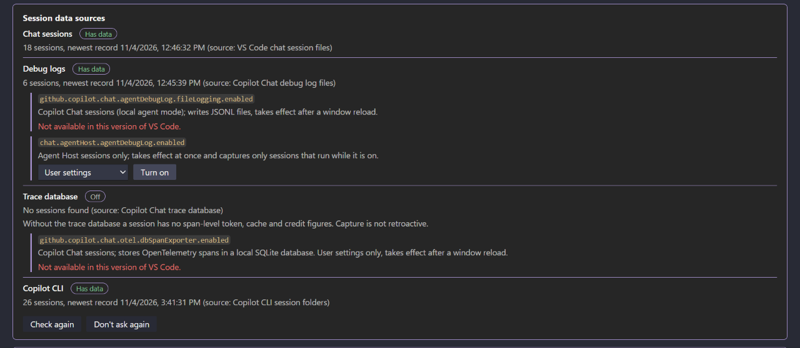
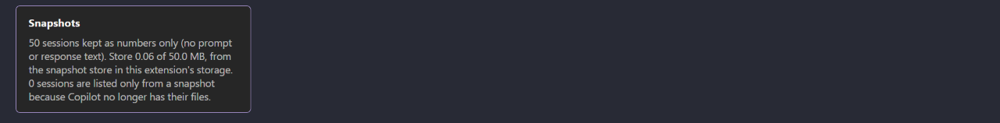

# Copilot Harness

**See what your Copilot harness holds, what your sessions cost, and bring your own models.**

Copilot Harness does for the GitHub Copilot harness what [Claude Harness](https://github.com/alexander-kastil/claude-harness) does for Claude Code. It puts every Copilot customization in one VS Code window, instructions, prompt files, agents, skills, hooks, MCP servers and plugins, globally and per repository, and reads the session data Copilot already writes, so you see which sessions ran, in which repository, with which models, and what they cost in tokens and credits.

It also brings your own models into Copilot Chat: any OpenAI-compatible, OpenAI Responses, Ollama, Anthropic or Gemini endpoint shows up in the model picker, with your own key.

*BYOK models run on your own provider accounts and keys. Copilot Harness adds no charge.*

## Quick start

Copilot Harness is not on the Marketplace yet: install it from its VSIX.

1. In the Extensions view (Ctrl+Shift+X), open the **...** menu, pick **Install from VSIX...** and select `copilot-harness-<version>.vsix`. You can also run `code --install-extension copilot-harness-<version>.vsix` in a terminal.
2. Click **Copilot Harness** in the status bar, or run **Copilot Harness: Open** from the Command Palette. The overview opens in the editor area.
3. Pick an item in the left nav to open it, or a session in **Last sessions**.
4. To add your own models, run **Manage BYOK Models**, or open the **PAYG models** tile on the overview.

> Note: Copilot Harness needs VS Code 1.119 or newer. The Copilot CLI is optional: its sessions are read from `~/.copilot` when that folder exists.

## Why Copilot Harness

Copilot customizations live in many places: the workspace, each VS Code profile, `~/.copilot`, `~/.claude`, `~/.agents` and installed plugins. Session data is just as scattered, across chat session files, debug logs, a trace database and the Copilot CLI's session state, and Copilot deletes some of it over time.

Copilot Harness reads all of it read-only and shows it in one place. Nothing joins your sessions, no proxy or server. Only numbers and names are kept: no prompt or response text, and of a customization file only its frontmatter keys.

## Top 10 features

| Feature | What it does |
| --- | --- |
| [Overview](#overview) | One page with a tile per customization kind, your last sessions, your repositories and the files changed most recently |
| [Every customization in one tree](#every-customization-in-one-tree) | Seven kinds across the workspace, every VS Code profile, `~/.copilot`, `~/.claude`, `~/.agents` and plugins, globally and per repository |
| [Sessions from every source](#sessions-from-every-source) | Chat sessions, debug logs, the trace database and Copilot CLI sessions in one list, with turns, models, tokens and credits |
| [Repositories](#repositories) | Each repository's customizations by kind, its sessions and credits of the last 7 days, and its last session |
| [Credits](#credits) | Reconciles the credits your local data explains against the quota GitHub reports, and shows what is left unexplained |
| [Setup check](#setup-check) | Shows which session sources are on, and switches on the opt-in ones from the card |
| [Snapshot store](#snapshot-store) | Keeps the numbers of every session it has seen, so sessions stay listed after Copilot deletes their files |
| [BYOK models in Copilot Chat](#byok-models-in-copilot-chat) | Your own providers and models in the Copilot Chat model picker, with five API modes and keys in VS Code's secret storage |
| [PAYG models page](#payg-models-page) | Everything Manage BYOK Models does, as a page: providers, models, keys, import and export |
| [Commit messages and token meter](#commit-messages-and-token-meter) | Writes the commit message with a BYOK model, and shows the current model's context use in the status bar |

## Overview

The overview opens with the asset and repository counts and one tile per customization kind with its global count, plus a **PAYG models** tile. Three tabs with a search box sit below:

- **Last sessions:** up to 300 sessions with their source, repository, start, turns, models, tokens and credits. A Copilot CLI row shows the session's name, or its summary when it has none.
- **Repositories:** every repository with its counts per kind.
- **Recently changed:** the 100 customization files changed last.

The Setup, Credits and Snapshots cards follow under the tabs.

## Every customization in one tree

The left nav has two regions. **Copilot** holds the global customizations of your VS Code profiles, `~/.copilot`, `~/.claude`, `~/.agents` and installed plugins. **Repositories** holds each repository, open folders first, with its kinds and its **Sessions**.

| Kind | In a repository |
| --- | --- |
| Instructions | `.github/copilot-instructions.md`, `.github/instructions/*.instructions.md`, `AGENTS.md`, `CLAUDE.md` |
| Prompt files | `.github/prompts/*.prompt.md` |
| Agents | `.github/agents/*.agent.md`, `.claude/agents/*.md` |
| Skills | `SKILL.md` folders in `.github/skills`, `.claude/skills` and `.agents/skills` |
| Hooks | `.github/hooks/*.json`, `.github/hooks.json`, the hooks in `.claude/settings.json` |
| MCP servers | `.vscode/mcp.json`, `.mcp.json` |
| Plugins | `.github/plugins` and installed plugins (read-only) |

The profiles of Code, Code - Insiders, VSCodium and Cursor are all read. A row opens its file in the editor; **Add repo** and **Remove repo** change the list (remove only hides a repository from the nav). The nav has a filter, region and group folds, sorting by recent or name, keyboard navigation, and collapses to a rail of icons with their counts (Alt+Shift+B). Its state is kept between sessions.

## Sessions from every source

| Source | What is read |
| --- | --- |
| Chat | VS Code chat session files of every installed VS Code variant: title, turns, models and times, rescanned incrementally |
| Debug log | Copilot Chat debug logs: tokens per call, tool counts and subagent runs |
| Trace DB | The OpenTelemetry trace database, opened read-only: token, cache and credit figures |
| CLI | Copilot CLI session state under `~/.copilot`: workspace, repository, branch, models, tool, subagent and skill counts, and every usage snapshot |

## Repositories

The **Repositories** tab and region list every repository with the number of customizations of each kind, its sessions and credits over the last 7 days, and when it last had a session.

## Credits

The Credits card sets the credit figures from your local session data, per source, against the quota used. The quota is read from GitHub with your signed-in GitHub session when you press the button, and no token is stored; you can also type it in. Every figure names its source, and the remainder no local data explains is shown on its own.

## Setup check

The **Session data sources** card shows the status of chat sessions, debug logs, the trace database and Copilot CLI data. Three sources are opt-in, and the card switches them on in your user settings: the agent debug log, its file logging and the OpenTelemetry database exporter. The card warns that these store plain text and need a window reload.

## Snapshot store

Every Copilot session the extension sees is kept as numbers only in the extension's own storage, so sessions stay listed after Copilot deletes their files. The store is capped at 50 MB by default (`copilotHarness.snapshots.maxMegabytes`), and the oldest sessions go first.

## BYOK models in Copilot Chat

Copilot Harness registers as a language model provider, so your models appear in the Copilot Chat model picker next to Copilot's own. It is ported from OAI Compatible Provider for Copilot.

- **Providers:** an ID, a base URL, an API mode, extra headers and a key. Keys live in VS Code's secret storage.
- **Five API modes:** OpenAI Chat Completions, OpenAI Responses, Ollama, Anthropic and Gemini.
- **Models:** add them from a provider's live model list, or by hand.
- **Import and export:** import your OAI Compatible settings in one step, or a file someone exported. An export file holds the keys in plain text.
- **Resilience:** retries on 429, 500, 502, 503 and 504, and an optional delay between requests.

Run **Manage BYOK Models** from the Command Palette for the menu.

## PAYG models page

The **PAYG models** tile opens a page with every BYOK provider (base URL, API mode, header names, model count and whether a key is set, never its value) and every model. Everything the Manage BYOK Models menu does is a control on the page, with a confirm card before each change: add, edit and remove providers, set or remove keys (typed into VS Code's password box), fetch a provider's models and add them, edit model fields and the global settings, import from OAI Compatible or a file, and export.

## Commit messages and token meter

- **Commit messages:** **Generate Commit Message with BYOK Model**, the wand in the Source Control title bar, writes the message with a model you marked for commit generation, in one of 14 languages and with your own prompt if you set one. A progress notification has **Stop**.
- **Token meter:** a status bar item shows how much of the current BYOK model's context the conversation uses, turns to a warning at 70% and an error at 90%, and opens Manage BYOK Models on click.

## License

Copilot Harness License 1.0: internal use, no redistribution or derived works. (c) 2026 Alexander Kastil, [integrations.at](https://integrations.at). See [LICENSE](LICENSE).
